# UniRide — Documento de Projeto

Projeto Integrador 2026/2 · Turma 0101 · Grupo 02

Tarefa 6 · Versão preliminar de 22/11/2026 · Prazo: 23/11/2026 às 23h59

## 1. Visão geral

**Responsável pelo capítulo:** Andres Olate Gonzalez Claudino.

### Problema

Horários limitados, custo e disponibilidade de transporte dificultam o deslocamento de estudantes até a PUC-Campinas, especialmente no período noturno.

### Público

O UniRide conecta estudantes da PUC-Campinas que oferecem caronas e estudantes que precisam se deslocar até a universidade ou sair dela. O motorista publica a oferta com horário, vagas e valor. O passageiro consulta ofertas, busca opções compatíveis e solicita uma vaga pelo aplicativo.

### Evidência e limites da pesquisa

Na pesquisa exploratória da Entrega 1, cinco dos sete participantes estudavam à noite, quatro gastavam mais de R$ 300 mensais no transporte, quatro levavam pelo menos 30 minutos para chegar à faculdade e seis responderam “Sim” ou “Talvez” sobre usar um aplicativo de transporte universitário. Esses resultados descrevem os estudantes consultados. A amostra não permite estimar a demanda de toda a universidade. [Escopo da Entrega 1, p. 1](escopo.pdf#page=1).

### Escopo E1–E8

O MVP abrange cadastro e login (E1), perfil (E2), cadastro de carona (E3), listagem (E4), busca (E5), solicitação de vaga (E6), avaliações (E7) e servidor com API em Java (E8). O [capítulo 3](#3-requisitos-funcionais-e-não-funcionais) detalha os critérios e a evolução de cada fluxo.

### Fora do escopo

O MVP registra o valor informado pelo motorista. Pagamento integrado, chat, acompanhamento por GPS em tempo real, cálculo de rotas e expansão a outras universidades permanecem fora do escopo. O ranking implementado auxilia a escolha do passageiro com horário e distância em linha reta entre pontos, sem agendamento automático.

Grupo: Andres Olate Gonzalez Claudino, Ibrahim Fleury De Camargo Madeira Neto, João Gabriel Altarujo, Leonardo Carlos Barboza Filho, Tonianni Leitão Calsolari e Victor Hugo Asvolinsque. [README acadêmico](../README.md).

## 2. Objetivos

**Responsável pelo capítulo:** João Gabriel Altarujo.

O objetivo geral da Entrega 1 é facilitar a oferta e a busca de caronas entre estudantes da PUC-Campinas, com apoio de um servidor Java e foco em praticidade, confiança e custo de deslocamento. [Escopo, p. 2](escopo.pdf#page=2).

| Objetivo específico | Desdobramento no MVP |
| --- | --- |
| OE1 — Permitir a oferta de caronas | O motorista informa sentido, campus, ponto variável, horário, vagas e valor. |
| OE2 — Permitir encontrar caronas e solicitar uma vaga | O passageiro consulta a lista, busca ofertas ranqueadas e acompanha o pedido. |
| OE3 — Disponibilizar identificação e avaliação | O estudante informa RA e e-mail institucional, consulta o perfil e avalia participantes após a conclusão. |

O critério de sucesso definido no escopo para dezembro é demonstrar com dois estudantes o fluxo de oferecer, encontrar e solicitar uma carona, com persistência pelo servidor Java e exibição no aplicativo. A confirmação experimental desse critério requer a evidência ponta a ponta indicada no capítulo 7.

## 3. Requisitos funcionais e não funcionais

**Responsável pelo capítulo:** Ibrahim Fleury De Camargo Madeira Neto.

Os IDs E e CT são os das entregas. RNF e TE são identificadores deste documento para rastrear características técnicas e casos de teste, respectivamente.

### Critérios do escopo e aceite da implementação

Os textos entre aspas reproduzem o campo “Feito quando” da [Entrega 1](escopo.pdf#page=2). O escopo original informa tamanhos. A prioridade aqui é uma proposta baseada no critério de sucesso do MVP. E1–E6 têm prioridade Alta por habilitarem o acesso e a jornada de oferecer, encontrar e solicitar uma carona. E8 tem prioridade Alta por sustentar essa jornada com a API, a persistência e a análise de compatibilidade. E7 tem prioridade Média por ocorrer após a viagem e contribuir para a confiança entre participantes. Todos permanecem no escopo.

| ID | Prioridade proposta | Situação atual | Feito quando (Entrega 1) | Aceite verificável na versão atual | Evolução após a Entrega 1 |
| --- | --- | --- | --- | --- | --- |
| E1 | Alta | Implementado no código, aceite pela interface pendente | “O estudante cria uma conta e entra no aplicativo com seus dados. Dados inválidos impedem o acesso e exibem uma mensagem.” | Criar conta válida e entrar com seus dados. Repetir com credenciais ou cadastro inválidos e observar a mensagem e o bloqueio. | RA único, login por RA ou e-mail e início da sessão no cadastro. |
| E2 | Alta | Implementado no código, aceite pela interface pendente | “O estudante visualiza seus dados e indica se também deseja oferecer caronas como motorista.” | Abrir o perfil, conferir os dados, alternar a habilitação de motorista e verificar a atualização ao consultar novamente. | Média e quantidade de avaliações recebidas. |
| E3 | Alta | Implementado no código, aceite pela interface pendente | “O motorista informa destino, horário, quantidade de vagas e valor, e a carona passa a aparecer como disponível.” | Publicar como motorista uma oferta futura válida. Conferir a confirmação e sua presença na lista inicial. | Sentido, campus e ponto geográfico variável, com autocomplete ou localização pontual. |
| E4 | Alta | Implementado no código, verificação HTTP confirmada, aceite pela interface pendente | “O passageiro visualiza as caronas cadastradas com destino, horário, vagas e valor.” | Abrir a lista com ofertas futuras elegíveis. Conferir destino, horário, vagas e valor de cada oferta. | Estados visuais de disponibilidade e lotação. |
| E5 | Alta | Implementado no código, verificação HTTP confirmada, aceite pela interface pendente | “O passageiro informa destino ou horário e visualiza as caronas compatíveis disponíveis.” | Buscar com sentido, campus, ponto variável e horário válidos. Conferir que os resultados atendem ao CT10 e preservam o ranking. | Busca por critérios combinados, ranking por horário e distância e uma vaga por busca. |
| E6 | Alta | Implementado no código, aceite pela interface pendente | “O passageiro solicita uma vaga e o motorista consegue visualizar, aceitar ou recusar a solicitação.” | Solicitar uma vaga, encontrar o pedido como motorista e verificar aceite e recusa em pedidos distintos. Conferir a mudança de estado e a redução de vagas apenas no aceite. | Acompanhamento e cancelamento de pendentes e avisos de aceite ou recusa. |
| E7 | Média | Implementado no código, aceite pela interface pendente | “Após uma carona concluída, motorista e passageiro conseguem registrar uma avaliação simples um do outro.” | Concluir uma carona elegível, avaliar nos dois sentidos em sessões distintas e verificar o bloqueio de uma avaliação duplicada. | Conclusão manual, histórico persistido e seleção de participantes elegíveis. |
| E8 | Alta | Implementado no código, verificação HTTP confirmada, aceite pela interface pendente | “O aplicativo envia, consulta e salva dados de usuários, caronas e solicitações por meio do servidor em Java.” | Cadastrar usuário, publicar carona, buscar e solicitar vaga pelo app. Conferir leitura e gravação no Backend 1 com PostgreSQL e a análise de busca pelo Backend 2. | Separação entre API/persistência e compatibilidade TCP. |

### Rastreabilidade entre objetivos, fluxos, contratos e testes

| Entregável e fluxo | Objetivo | Comportamento implementado | Contratos | Testes |
| --- | --- | --- | --- | --- |
| [E1](https://github.com/ibrahimfcmneto/pi4-0101-g2-frontend/blob/cce418c1aed120dba3f969ff73305bb16bb66ee6/docs/fluxos/E1-cadastro-login.md) Cadastro e login | OE3 | Cadastro com nome, RA único de oito dígitos, e-mail institucional e senha. O cadastro inicia a sessão em memória. Acessos posteriores aceitam RA ou e-mail com senha. | [CT1](https://github.com/ibrahimfcmneto/pi4-0101-g2-backend-1/blob/a30416d62efc28a0d10019c53768e7891bdd843d/docs/contratos/CT1-cadastrar-usuario.md), [CT2](https://github.com/ibrahimfcmneto/pi4-0101-g2-backend-1/blob/a30416d62efc28a0d10019c53768e7891bdd843d/docs/contratos/CT2-usuario.md), [CT3](https://github.com/ibrahimfcmneto/pi4-0101-g2-backend-1/blob/a30416d62efc28a0d10019c53768e7891bdd843d/docs/contratos/CT3-entrar.md) | TE01 |
| [E2](https://github.com/ibrahimfcmneto/pi4-0101-g2-frontend/blob/cce418c1aed120dba3f969ff73305bb16bb66ee6/docs/fluxos/E2-perfil.md) Perfil | OE3 | Consulta dados e avaliações recebidas. A edição altera a habilitação para oferecer caronas. | [CT2](https://github.com/ibrahimfcmneto/pi4-0101-g2-backend-1/blob/a30416d62efc28a0d10019c53768e7891bdd843d/docs/contratos/CT2-usuario.md), [CT4](https://github.com/ibrahimfcmneto/pi4-0101-g2-backend-1/blob/a30416d62efc28a0d10019c53768e7891bdd843d/docs/contratos/CT4-consultar-perfil.md), [CT5](https://github.com/ibrahimfcmneto/pi4-0101-g2-backend-1/blob/a30416d62efc28a0d10019c53768e7891bdd843d/docs/contratos/CT5-atualizar-perfil.md), [CT16](https://github.com/ibrahimfcmneto/pi4-0101-g2-backend-1/blob/a30416d62efc28a0d10019c53768e7891bdd843d/docs/contratos/CT16-avaliacao.md) | TE02 |
| [E3](https://github.com/ibrahimfcmneto/pi4-0101-g2-frontend/blob/cce418c1aed120dba3f969ff73305bb16bb66ee6/docs/fluxos/E3-cadastro-carona.md) Cadastro de carona | OE1 | Motorista habilitado publica data e hora futuras até um ano, 1–4 vagas, valor de R$ 1 a R$ 50 e ponto variável com texto e coordenadas. | [CT6](https://github.com/ibrahimfcmneto/pi4-0101-g2-backend-1/blob/a30416d62efc28a0d10019c53768e7891bdd843d/docs/contratos/CT6-criar-carona.md), [CT7](https://github.com/ibrahimfcmneto/pi4-0101-g2-backend-1/blob/a30416d62efc28a0d10019c53768e7891bdd843d/docs/contratos/CT7-carona.md) | TE03, TE09 |
| [E4](https://github.com/ibrahimfcmneto/pi4-0101-g2-frontend/blob/cce418c1aed120dba3f969ff73305bb16bb66ee6/docs/fluxos/E4-lista-caronas.md) Lista | OE2 | Exibe caronas futuras de status persistido `disponivel`, incluindo as de zero vagas. O Flutter deriva “Lotada” das vagas e trata a ausência de status apenas no contexto do CT8. | [CT7](https://github.com/ibrahimfcmneto/pi4-0101-g2-backend-1/blob/a30416d62efc28a0d10019c53768e7891bdd843d/docs/contratos/CT7-carona.md), [CT8](https://github.com/ibrahimfcmneto/pi4-0101-g2-backend-1/blob/a30416d62efc28a0d10019c53768e7891bdd843d/docs/contratos/CT8-listar-caronas.md) | TE04 |
| [E5](https://github.com/ibrahimfcmneto/pi4-0101-g2-frontend/blob/cce418c1aed120dba3f969ff73305bb16bb66ee6/docs/fluxos/E5-busca-caronas.md) Busca de carona | OE2 | Usa sentido, campus, ponto variável e data/hora. A busca pública representa uma vaga. A API preserva o ranking produzido pelo servidor TCP. | [CT7](https://github.com/ibrahimfcmneto/pi4-0101-g2-backend-1/blob/a30416d62efc28a0d10019c53768e7891bdd843d/docs/contratos/CT7-carona.md), [CT9](https://github.com/ibrahimfcmneto/pi4-0101-g2-backend-1/blob/a30416d62efc28a0d10019c53768e7891bdd843d/docs/contratos/CT9-buscar-caronas.md), [CT10](https://github.com/ibrahimfcmneto/pi4-0101-g2-backend-2/blob/5c28974aa2a220f480a3107536462c98e3f25420/docs/contratos/CT10-analisar-compatibilidade.md) | TE05, TE08 |
| [E6](https://github.com/ibrahimfcmneto/pi4-0101-g2-frontend/blob/cce418c1aed120dba3f969ff73305bb16bb66ee6/docs/fluxos/E6-solicitacao-vaga.md) Solicitação de vaga | OE2 | O passageiro solicita vaga, acompanha pedidos e pode cancelar os pendentes. O motorista consulta, aceita ou recusa. Aceite e recusa geram notificação no aplicativo. | [CT7](https://github.com/ibrahimfcmneto/pi4-0101-g2-backend-1/blob/a30416d62efc28a0d10019c53768e7891bdd843d/docs/contratos/CT7-carona.md), [CT11](https://github.com/ibrahimfcmneto/pi4-0101-g2-backend-1/blob/a30416d62efc28a0d10019c53768e7891bdd843d/docs/contratos/CT11-solicitar-vaga.md), [CT12](https://github.com/ibrahimfcmneto/pi4-0101-g2-backend-1/blob/a30416d62efc28a0d10019c53768e7891bdd843d/docs/contratos/CT12-solicitacao.md), [CT13](https://github.com/ibrahimfcmneto/pi4-0101-g2-backend-1/blob/a30416d62efc28a0d10019c53768e7891bdd843d/docs/contratos/CT13-listar-solicitacoes.md), [CT14](https://github.com/ibrahimfcmneto/pi4-0101-g2-backend-1/blob/a30416d62efc28a0d10019c53768e7891bdd843d/docs/contratos/CT14-responder-solicitacao.md), [CT20](https://github.com/ibrahimfcmneto/pi4-0101-g2-backend-1/blob/a30416d62efc28a0d10019c53768e7891bdd843d/docs/contratos/CT20-notificacoes.md), [CT21](https://github.com/ibrahimfcmneto/pi4-0101-g2-backend-1/blob/a30416d62efc28a0d10019c53768e7891bdd843d/docs/contratos/CT21-listar-minhas-solicitacoes.md), [CT22](https://github.com/ibrahimfcmneto/pi4-0101-g2-backend-1/blob/a30416d62efc28a0d10019c53768e7891bdd843d/docs/contratos/CT22-cancelar-solicitacao.md) | TE06, TE09 |
| [E7](https://github.com/ibrahimfcmneto/pi4-0101-g2-frontend/blob/cce418c1aed120dba3f969ff73305bb16bb66ee6/docs/fluxos/E7-avaliacao.md) Avaliação | OE3 | Motorista conclui manualmente a carona a partir do horário previsto. Histórico mantém motorista e passageiros aceitos, permitindo avaliação de 1 a 5 entre motorista e passageiro. A avaliação repetida do mesmo participante na mesma carona é bloqueada. | [CT7](https://github.com/ibrahimfcmneto/pi4-0101-g2-backend-1/blob/a30416d62efc28a0d10019c53768e7891bdd843d/docs/contratos/CT7-carona.md), [CT15](https://github.com/ibrahimfcmneto/pi4-0101-g2-backend-1/blob/a30416d62efc28a0d10019c53768e7891bdd843d/docs/contratos/CT15-registrar-avaliacao.md), [CT16](https://github.com/ibrahimfcmneto/pi4-0101-g2-backend-1/blob/a30416d62efc28a0d10019c53768e7891bdd843d/docs/contratos/CT16-avaliacao.md), [CT17](https://github.com/ibrahimfcmneto/pi4-0101-g2-backend-1/blob/a30416d62efc28a0d10019c53768e7891bdd843d/docs/contratos/CT17-concluir-carona.md), [CT18](https://github.com/ibrahimfcmneto/pi4-0101-g2-backend-1/blob/a30416d62efc28a0d10019c53768e7891bdd843d/docs/contratos/CT18-consultar-historico-caronas.md) | TE07, TE09 |
| [E8](https://github.com/ibrahimfcmneto/pi4-0101-g2-frontend/blob/cce418c1aed120dba3f969ff73305bb16bb66ee6/docs/fluxos/E8-servidor-api-java.md) Servidor e API Java | OE1–OE3 | O Backend 1 concentra API, regras e persistência. O Backend 2 recebe pedidos TCP de compatibilidade e devolve ofertas ordenadas. | [CT2](https://github.com/ibrahimfcmneto/pi4-0101-g2-backend-1/blob/a30416d62efc28a0d10019c53768e7891bdd843d/docs/contratos/CT2-usuario.md), [CT7](https://github.com/ibrahimfcmneto/pi4-0101-g2-backend-1/blob/a30416d62efc28a0d10019c53768e7891bdd843d/docs/contratos/CT7-carona.md), [CT9](https://github.com/ibrahimfcmneto/pi4-0101-g2-backend-1/blob/a30416d62efc28a0d10019c53768e7891bdd843d/docs/contratos/CT9-buscar-caronas.md), [CT10](https://github.com/ibrahimfcmneto/pi4-0101-g2-backend-2/blob/5c28974aa2a220f480a3107536462c98e3f25420/docs/contratos/CT10-analisar-compatibilidade.md), [CT12](https://github.com/ibrahimfcmneto/pi4-0101-g2-backend-1/blob/a30416d62efc28a0d10019c53768e7891bdd843d/docs/contratos/CT12-solicitacao.md), [CT16](https://github.com/ibrahimfcmneto/pi4-0101-g2-backend-1/blob/a30416d62efc28a0d10019c53768e7891bdd843d/docs/contratos/CT16-avaliacao.md) | TE08, TE09, TE11 |
| Complemento aos fluxos E6/E7 | OE2, OE3 | O motorista cancela a carona disponível. Pendentes são recusadas, aceitas ficam no histórico e seus passageiros recebem aviso. A tela de notificações consulta e marca avisos como lidos. | [CT12](https://github.com/ibrahimfcmneto/pi4-0101-g2-backend-1/blob/a30416d62efc28a0d10019c53768e7891bdd843d/docs/contratos/CT12-solicitacao.md), [CT18](https://github.com/ibrahimfcmneto/pi4-0101-g2-backend-1/blob/a30416d62efc28a0d10019c53768e7891bdd843d/docs/contratos/CT18-consultar-historico-caronas.md), [CT19](https://github.com/ibrahimfcmneto/pi4-0101-g2-backend-1/blob/a30416d62efc28a0d10019c53768e7891bdd843d/docs/contratos/CT19-cancelar-carona.md), [CT20](https://github.com/ibrahimfcmneto/pi4-0101-g2-backend-1/blob/a30416d62efc28a0d10019c53768e7891bdd843d/docs/contratos/CT20-notificacoes.md) | TE10 |

No E5, a expressão histórica “destino ou horário” pertence ao critério original da Entrega 1. O fluxo atual exige o conjunto de critérios indicado na tabela. No E3 e no E5, em `PARA_PUC` o ponto variável é a origem. Em `SAINDO_DA_PUC` é o destino. O Campus I ou II é o outro extremo. O ponto pode vir do autocomplete ou de uma leitura pontual da localização atual.

| ID | Característica verificável | Rastreabilidade | Como verificar |
| --- | --- | --- | --- |
| RNF01 | Senha armazenada em hash BCrypt. Respostas de usuário omitem senha e hash. O Flutter mantém a identificação em memória. O ID recebido pela API é uma identificação declarada pelo cliente, sem comprovação por token. | E1/E2, CT1–CT5, TE01–TE02 | Cadastrar conta de teste, inspecionar o hash no banco e checar que login/perfil não o devolvem. Encerrar e reabrir o aplicativo para verificar a perda da sessão. |
| RNF02 | JSON em HTTP entre Flutter e Backend 1. Objetos Java serializados sobre TCP no CT10. | E8, CT9–CT10, TE05, TE08 | Conferir a requisição e resposta JSON do CT9 e executar a troca CT10 por socket, conferindo mensagem, resultado e encerramento. |
| RNF03 | PostgreSQL para dados persistentes. Flyway versiona o esquema e o Hibernate opera com `ddl-auto=none`. Chaves e restrições protegem a integridade. | E8, CT2/CT7/CT12/CT16/CT20, TE09, TE11 | Subir PostgreSQL vazio em ambiente descartável, conferir o histórico Flyway V1–V9, reiniciar preservando o volume e verificar leitura dos registros. |
| RNF04 | Falhas HTTP usam `codigo` e `mensagem`. A comunicação CT10 tem limites de conexão e leitura, e os clientes HTTP do Flutter têm timeout. | E5/E8, CT9–CT10, TE08, TE12 | Provocar indisponibilidade TCP e timeout HTTP controlados. Conferir o retorno com código/mensagem e a apresentação compreensível no app. |
| RNF05 | A aceitação de vaga ocorre em transação com bloqueio pessimista de carona. A última vaga é disputada sob teste de concorrência. | E6, CT7/CT12/CT14, TE06 | Responder em paralelo a dois pedidos para uma carona com uma vaga. Conferir um aceite, estoque zero e rejeição do segundo aceite. |
| RNF06 | Datas trafegam em ISO 8601 local. O Backend 1 usa o fuso `America/Sao_Paulo` nas validações com `Clock`. | E3/E5/E7, CT6/CT9/CT17, TE03/TE05/TE07 | Com relógio fixo, verificar oferta e busca futuras, rejeição de horário passado e conclusão no horário previsto. Conferir horário local sem offset no payload. |
| RNF07 | Flutter tem instruções para Android e web. CORS de desenvolvimento admite `http://localhost:*` e métodos GET, POST, PATCH e OPTIONS. | E1–E7, TE11 | Abrir no Chrome com origem localhost e no Android Emulator. Conferir preflight CORS e executar uma consulta de lista e uma operação PATCH. |
| RNF08 | A posição é consultada por ação do usuário. Se a permissão faltar, o ponto pode ser selecionado manualmente por autocomplete. | E3/E5, CT6/CT9, TE03 | Negar permissão e completar o formulário por autocomplete. Em nova tentativa, autorizar e solicitar a posição uma vez. |

Esses RNFs descrevem mecanismos implementados. Metas de desempenho, disponibilidade, cobertura, acessibilidade e segurança de produção não foram medidas nesta etapa.

## 4. Arquitetura

**Responsável pelo capítulo:** Victor Hugo Asvolinsque.

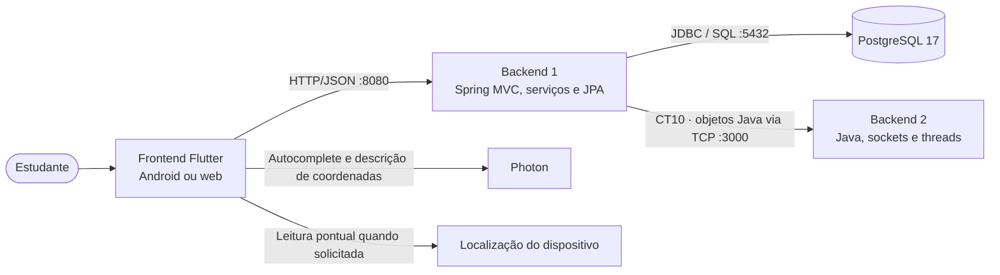

O Flutter usa telas, widgets, modelos e serviços. `ApiService` concentra o acesso à API, `SessaoUsuario` mantém a sessão em memória e `EnderecoService` consulta o Photon. O Backend 1 usa Java 25 e Spring Boot 4.1.1. Controllers recebem os DTOs, services aplicam as regras e repositories acessam o PostgreSQL via JPA. O Backend 2 usa Java 17, sem dependência do banco. A aceitação do socket fica em `AceitadoraDeConexao`, cada conexão usa uma `SupervisoraDeConexao` e `Parceiro` encapsula leitura, escrita e fechamento.

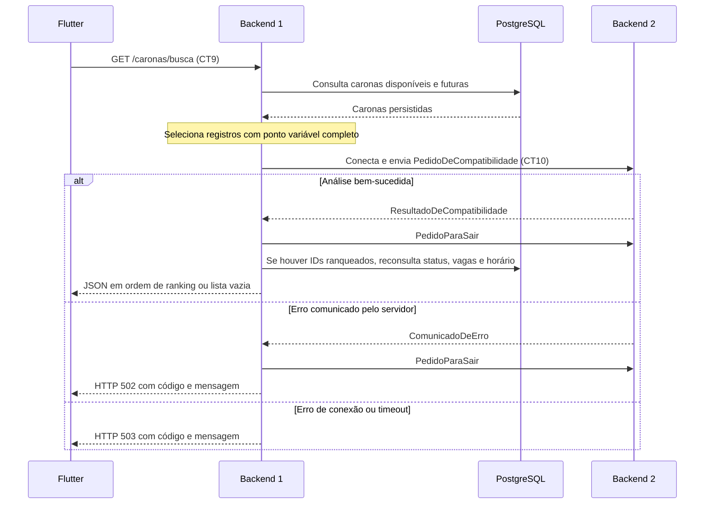

No CT10, ambas as pontas criam e descarregam o cabeçalho do `ObjectOutputStream` antes de abrir o `ObjectInputStream`. O pedido inclui critérios, quantidade igual a 1 e objetos `DadosDaCarona`. A resposta contém `caronasRanqueadas`, cujos itens têm `caronaId`, `pontuacao` e `distanciaKm`. Depois de receber uma resposta, o cliente tenta enviar `PedidoParaSair` e libera socket e streams. Os dois módulos mantêm classes de protocolo no mesmo namespace Java, com as mesmas assinaturas serializáveis. Os padrões no Backend 1 são 2 s para conexão e 5 s para leitura. O Flutter limita chamadas da API a 15 s e consultas de endereço a 10 s.

O analisador elimina sentido, campus ou dia divergente, diferença superior a 360 minutos ou falta de vaga. Usa até 60 pontos por proximidade de horário e até 40 por distância Haversine. A pontuação de horário é `60 × (1 − minutos/360)` e a de distância é `40 ÷ (1 + km/5)`. Distância afeta somente a ordem. O desempate usa o menor ID. O Backend 1 repassa a pontuação e a distância sem recalculá-las. [CT9](https://github.com/ibrahimfcmneto/pi4-0101-g2-backend-1/blob/a30416d62efc28a0d10019c53768e7891bdd843d/docs/contratos/CT9-buscar-caronas.md), [CT10](https://github.com/ibrahimfcmneto/pi4-0101-g2-backend-2/blob/5c28974aa2a220f480a3107536462c98e3f25420/docs/contratos/CT10-analisar-compatibilidade.md).

O Compose sobe os dois backends e o PostgreSQL 17. Os Dockerfiles usam build Maven e imagens de execução Temurin 25 e 17, respectivamente. O volume `uniride_postgres` mantém os dados. O PostgreSQL fica na rede interna. As portas 8080 e 3000 estão publicadas na configuração de demonstração. [Compose](../compose.yaml) · [Dockerfile Backend 1](https://github.com/ibrahimfcmneto/pi4-0101-g2-backend-1/blob/a30416d62efc28a0d10019c53768e7891bdd843d/Dockerfile) · [Dockerfile Backend 2](https://github.com/ibrahimfcmneto/pi4-0101-g2-backend-2/blob/5c28974aa2a220f480a3107536462c98e3f25420/Dockerfile).

### Implantação com Docker Compose

| Serviço no Compose | Imagem ou origem do build | Porta interna | Porta publicada no host | Dependências e verificação |
| --- | --- | --- | --- | --- |
| `postgres` | `postgres:17-alpine` | 5432/TCP | Nenhuma | Sem dependência declarada. Healthcheck com `pg_isready`. Volume `uniride_postgres`. |
| `backend2` | Build em `../pi4-0101-g2-backend-2`, com Maven 3.9.11/Temurin 17 e execução em `eclipse-temurin:17-jre` | 3000/TCP | `3000:3000` | Sem dependência declarada. Healthcheck verifica o processo com `kill -0 1`. |
| `backend1` | Build em `../pi4-0101-g2-backend-1`, com `eclipse-temurin:25-jdk`, Maven Wrapper e execução em `eclipse-temurin:25-jre` | 8080/TCP (HTTP) | `8080:8080` | Aguarda `postgres` e `backend2` com `service_healthy`. Usa os nomes dos serviços, o profile `demo` e `TZ=America/Sao_Paulo`. |

Flutter, Photon e localização do dispositivo são componentes e dependências do fluxo, executados fora desse Compose.

## 5. Banco de dados

**Responsável pelo capítulo:** Tonianni Leitão Calsolari.

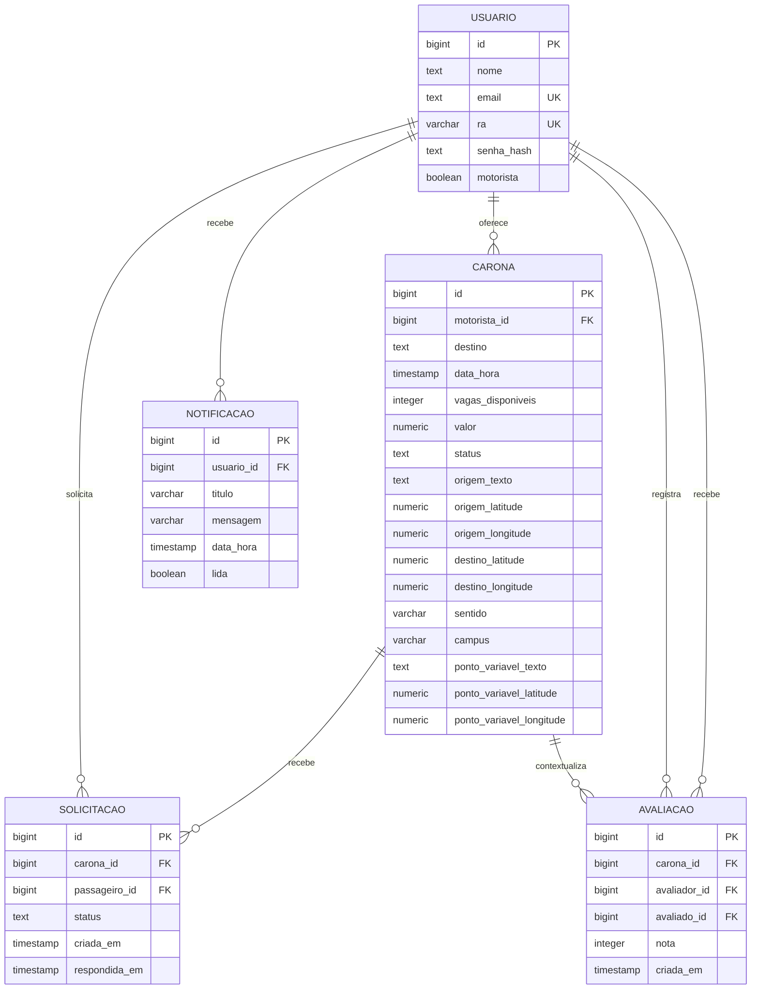

| Tabela | Dados e integridade |
| --- | --- |
| `usuario` | ID, nome, e-mail, RA, hash e indicador de motorista. E-mail normalizado e RA de oito dígitos são únicos. |
| `carona` | FK do motorista, destino, horário local, vagas não negativas, valor e status. Sentido, campus e ponto variável formam um conjunto completo no modelo novo. O esquema permite manter registros legados sem esse conjunto. |
| `solicitacao` | FKs da carona e do passageiro, status e horários. A combinação carona/passageiro é única. O cancelamento CT22 exclui o registro pendente. |
| `avaliacao` | FKs da carona, avaliador e avaliado, horário de criação e nota de 1 a 5. A combinação carona/avaliador/avaliado é única. |
| `notificacao` | FK do destinatário, título, mensagem, data/hora, indicador de leitura e índice por destinatário e data. |

| Migrations | Evolução do esquema |
| --- | --- |
| V1–V4 | Criação de usuário, carona, solicitação e avaliação, com chaves, índices e restrições. |
| V5 | Ampliação dos dados geográficos de origem e destino, com validação das coordenadas. |
| V6 | Sentido, campus e ponto variável, com validação de preenchimento conjunto. |
| V7–V9 | Criação de notificações, inclusão e preenchimento do RA em usuários existentes, normalização de e-mail e inclusão de título nas notificações. |

Os estados persistidos de carona são `disponivel`, `concluida` e `cancelada`. “Em curso” é derivado no histórico quando uma carona ainda disponível já atingiu seu horário. “Lotada” é uma apresentação de zero vagas. Solicitações persistem como `pendente`, `aceita` ou `recusada`. Concluir ou cancelar mantém participações aceitas e recusa as que ainda estiverem pendentes. [Migrations Flyway](https://github.com/ibrahimfcmneto/pi4-0101-g2-backend-1/tree/a30416d62efc28a0d10019c53768e7891bdd843d/src/main/resources/db/migration).

## 6. Contratos e decisões arquiteturais

**Responsável pelo capítulo:** João Gabriel Altarujo.

| Contrato | Nome | Fronteira |
| --- | --- | --- |
| [CT1](https://github.com/ibrahimfcmneto/pi4-0101-g2-backend-1/blob/a30416d62efc28a0d10019c53768e7891bdd843d/docs/contratos/CT1-cadastrar-usuario.md) | `cadastrarUsuario` | Flutter ↔ Backend 1 (HTTP/JSON) |
| [CT2](https://github.com/ibrahimfcmneto/pi4-0101-g2-backend-1/blob/a30416d62efc28a0d10019c53768e7891bdd843d/docs/contratos/CT2-usuario.md) | `usuario` | Backend 1 ↔ PostgreSQL (persistência) |
| [CT3](https://github.com/ibrahimfcmneto/pi4-0101-g2-backend-1/blob/a30416d62efc28a0d10019c53768e7891bdd843d/docs/contratos/CT3-entrar.md) | `entrar` | Flutter ↔ Backend 1 (HTTP/JSON) |
| [CT4](https://github.com/ibrahimfcmneto/pi4-0101-g2-backend-1/blob/a30416d62efc28a0d10019c53768e7891bdd843d/docs/contratos/CT4-consultar-perfil.md) | `consultarPerfil` | Flutter ↔ Backend 1 (HTTP/JSON) |
| [CT5](https://github.com/ibrahimfcmneto/pi4-0101-g2-backend-1/blob/a30416d62efc28a0d10019c53768e7891bdd843d/docs/contratos/CT5-atualizar-perfil.md) | `atualizarPerfil` | Flutter ↔ Backend 1 (HTTP/JSON) |
| [CT6](https://github.com/ibrahimfcmneto/pi4-0101-g2-backend-1/blob/a30416d62efc28a0d10019c53768e7891bdd843d/docs/contratos/CT6-criar-carona.md) | `criarCarona` | Flutter ↔ Backend 1 (HTTP/JSON) |
| [CT7](https://github.com/ibrahimfcmneto/pi4-0101-g2-backend-1/blob/a30416d62efc28a0d10019c53768e7891bdd843d/docs/contratos/CT7-carona.md) | `carona` | Backend 1 ↔ PostgreSQL (persistência) |
| [CT8](https://github.com/ibrahimfcmneto/pi4-0101-g2-backend-1/blob/a30416d62efc28a0d10019c53768e7891bdd843d/docs/contratos/CT8-listar-caronas.md) | `listarCaronas` | Flutter ↔ Backend 1 (HTTP/JSON) |
| [CT9](https://github.com/ibrahimfcmneto/pi4-0101-g2-backend-1/blob/a30416d62efc28a0d10019c53768e7891bdd843d/docs/contratos/CT9-buscar-caronas.md) | `buscarCaronas` | Flutter ↔ Backend 1 (HTTP/JSON) |
| [CT10](https://github.com/ibrahimfcmneto/pi4-0101-g2-backend-2/blob/5c28974aa2a220f480a3107536462c98e3f25420/docs/contratos/CT10-analisar-compatibilidade.md) | `analisarCompatibilidade` | Backend 1 ↔ Backend 2 (TCP com objetos Java) |
| [CT11](https://github.com/ibrahimfcmneto/pi4-0101-g2-backend-1/blob/a30416d62efc28a0d10019c53768e7891bdd843d/docs/contratos/CT11-solicitar-vaga.md) | `solicitarVaga` | Flutter ↔ Backend 1 (HTTP/JSON) |
| [CT12](https://github.com/ibrahimfcmneto/pi4-0101-g2-backend-1/blob/a30416d62efc28a0d10019c53768e7891bdd843d/docs/contratos/CT12-solicitacao.md) | `solicitacao` | Backend 1 ↔ PostgreSQL (persistência) |
| [CT13](https://github.com/ibrahimfcmneto/pi4-0101-g2-backend-1/blob/a30416d62efc28a0d10019c53768e7891bdd843d/docs/contratos/CT13-listar-solicitacoes.md) | `listarSolicitacoes` | Flutter ↔ Backend 1 (HTTP/JSON) |
| [CT14](https://github.com/ibrahimfcmneto/pi4-0101-g2-backend-1/blob/a30416d62efc28a0d10019c53768e7891bdd843d/docs/contratos/CT14-responder-solicitacao.md) | `responderSolicitacao` | Flutter ↔ Backend 1 (HTTP/JSON) |
| [CT15](https://github.com/ibrahimfcmneto/pi4-0101-g2-backend-1/blob/a30416d62efc28a0d10019c53768e7891bdd843d/docs/contratos/CT15-registrar-avaliacao.md) | `registrarAvaliacao` | Flutter ↔ Backend 1 (HTTP/JSON) |
| [CT16](https://github.com/ibrahimfcmneto/pi4-0101-g2-backend-1/blob/a30416d62efc28a0d10019c53768e7891bdd843d/docs/contratos/CT16-avaliacao.md) | `avaliacao` | Backend 1 ↔ PostgreSQL (persistência) |
| [CT17](https://github.com/ibrahimfcmneto/pi4-0101-g2-backend-1/blob/a30416d62efc28a0d10019c53768e7891bdd843d/docs/contratos/CT17-concluir-carona.md) | `concluirCarona` | Flutter ↔ Backend 1 (HTTP/JSON) |
| [CT18](https://github.com/ibrahimfcmneto/pi4-0101-g2-backend-1/blob/a30416d62efc28a0d10019c53768e7891bdd843d/docs/contratos/CT18-consultar-historico-caronas.md) | `consultarHistoricoDeCaronas` | Flutter ↔ Backend 1 (HTTP/JSON) |
| [CT19](https://github.com/ibrahimfcmneto/pi4-0101-g2-backend-1/blob/a30416d62efc28a0d10019c53768e7891bdd843d/docs/contratos/CT19-cancelar-carona.md) | `cancelarCarona` | Flutter ↔ Backend 1 (HTTP/JSON) |
| [CT20](https://github.com/ibrahimfcmneto/pi4-0101-g2-backend-1/blob/a30416d62efc28a0d10019c53768e7891bdd843d/docs/contratos/CT20-notificacoes.md) | `notificacoes` | Flutter ↔ Backend 1 (HTTP/JSON) |
| [CT21](https://github.com/ibrahimfcmneto/pi4-0101-g2-backend-1/blob/a30416d62efc28a0d10019c53768e7891bdd843d/docs/contratos/CT21-listar-minhas-solicitacoes.md) | `listarMinhasSolicitacoes` | Flutter ↔ Backend 1 (HTTP/JSON) |
| [CT22](https://github.com/ibrahimfcmneto/pi4-0101-g2-backend-1/blob/a30416d62efc28a0d10019c53768e7891bdd843d/docs/contratos/CT22-cancelar-solicitacao.md) | `cancelarSolicitacao` | Flutter ↔ Backend 1 (HTTP/JSON) |

A seção [API HTTP](https://github.com/ibrahimfcmneto/pi4-0101-g2-backend-1/blob/a30416d62efc28a0d10019c53768e7891bdd843d/docs/api-http.md) lista os métodos, rotas e respostas de erro. O guia de [acesso e identificação](https://github.com/ibrahimfcmneto/pi4-0101-g2-backend-1/blob/a30416d62efc28a0d10019c53768e7891bdd843d/docs/autenticacao.md) detalha a sessão em memória e o uso de IDs explícitos. O e-mail institucional e o RA são validados no cadastro, sem verificação externa de matrícula. A API HTTP local foi documentada como ambiente acadêmico. A validação de propriedade usa os IDs recebidos e não equivale a autenticação forte de cada requisição.

| ADR registrado | Título | Status no arquivo |
| --- | --- | --- |
| [0001](https://github.com/ibrahimfcmneto/pi4-0101-g2-backend-1/blob/a30416d62efc28a0d10019c53768e7891bdd843d/docs/adr/0001-adotar-api-rest-em-json-para-integrar-aplicativo-e-backend.md) | Adotar API REST em JSON para integrar aplicativo e backend | Aceito |
| [0002](https://github.com/ibrahimfcmneto/pi4-0101-g2-backend-1/blob/a30416d62efc28a0d10019c53768e7891bdd843d/docs/adr/0002-adotar-postgresql-para-persistir-dados-do-uniride.md) | Adotar PostgreSQL para persistir dados do UniRide | Aceito |

O CT10 e o fluxo E8 são as referências para o protocolo TCP. Foram encontrados dois ADRs no material examinado. Recomenda-se registrar o contexto, as alternativas e as consequências de três decisões que hoje aparecem no código ou em outros documentos: a divisão dos backends e o versionamento do protocolo TCP, o modelo de campus/ponto variável e a responsabilidade pelo ranking, e a sessão em memória com identificação explícita e suas limitações de segurança.

## 7. Testes

**Responsável pelo capítulo:** Ibrahim Fleury De Camargo Madeira Neto.

Os TEs abaixo agrupam casos automatizados identificados no código por objetivo verificável. Um grupo pode apontar para vários testes existentes.

| Caso | Cenário | Passos | Resultado esperado | Resultado obtido | Situação | Testes de referência |
| --- | --- | --- | --- | --- | --- | --- |
| TE01 | Cadastro e login | Cadastrar com dados válidos e inválidos, repetir RA/e-mail e entrar com RA, e-mail e senha errada. Conferir banco e sessão. | Cadastro envia os campos do CT1, rejeita dados inválidos e duplicados, guarda somente hash. Login por RA/e-mail preenche a sessão ou retorna erro. | Cadastro com senha protegida, rejeição de RA/e-mail duplicados e senha incorreta no Backend 1. O teste de widget cobriu a entrada com sessão em memória. | Automatizado confirmado. Login por RA confirmado na interface integrada. Envio do cadastro, login por e-mail e cenários inválidos na interface pendentes. | `UsuarioControllerTest`, `UsuarioServiceTest`, `fluxos_api_test.dart`, `widget_test.dart` |
| TE02 | Consulta e edição do perfil | Abrir o perfil, alternar o indicador de motorista, reconsultar e conferir sessão. | Perfil usa o ID da sessão e a alteração do campo motorista atualiza os dados. | Consulta e atualização do perfil exercitadas nos testes de API e no widget com sessão simulada. | Automatizado confirmado. Consulta confirmada na interface integrada. Alteração e reconsulta após atualização pendentes. | `UsuarioControllerTest`, `fluxos_api_test.dart`, `screen_states_test.dart` |
| TE03 | Publicação e localização opcional | Negar localização, selecionar o ponto manualmente e publicar com horário futuro próximo. Conferir a oferta. | Oferta aceita dados geográficos válidos e horário futuro próximo. Permissão negada deixa disponível a escolha manual. | Criação com dados geográficos e horário futuro exercitada no Backend 1. O teste de widget cobriu seleção manual após permissão negada. | Automatizado confirmado. Permissão em dispositivo e publicação pela interface pendentes. | `CaronaControllerTest`, `geolocalizacao_e3_test.dart`, `novas_alteracoes_test.dart` |
| TE04 | Listagem CT8 e lotação | Preparar ofertas futuras com e sem vagas e uma passada. Consultar CT8 e abrir a lista com payload sem status. | CT8 exclui estados inelegíveis e horários passados. JSON sem status exibe “Disponível” ou “Lotada”, conforme as vagas. | Testes de listagem no backend e estados de disponibilidade/lotação no widget. No Compose, CT8 respondeu HTTP 200 com 12 caronas. | Automatizado e consulta HTTP confirmados. Exibição dos cards com dados reais confirmada. | `CaronaControllerTest`, `screen_states_test.dart` |
| TE05 | Busca e ranking CT9 | Buscar ofertas de diferentes horários e distâncias. Repetir com critério inválido e sem correspondências. | Busca valida critérios e exibe ordem, pontuação e distância, com estados vazios e erros. | Testes de busca e apresentação do ranking. No Compose, CT9 retornou HTTP 200 e três resultados. A carona de referência teve 100 pontos e 0 km. | Automatizado e busca HTTP válida confirmados. Busca válida e abertura do primeiro resultado confirmadas na interface integrada. Cenários inválidos, vazios ou com erros na pilha real pendentes. | `BuscaCaronasControllerTest`, `fluxos_e5_e7_test.dart`, `melhorias_ux_test.dart` |
| TE06 | Solicitações e última vaga | Enviar pedidos, aceitar/recusar, cancelar um pendente e executar dois aceites paralelos para a última vaga. | Passageiro solicita, acompanha e cancela pendente. Motorista responde. Aceites concorrentes da última vaga não excedem a capacidade. | Testes de solicitações e disputa da última vaga executados. No teste de concorrência do Backend 1, uma única solicitação ocupou a vaga. | Automatizado confirmado. Aceite de pedido demo existente confirmado nos dois papéis e por SQL. Criação, recusa e cancelamento de pedido pela interface pendentes. | `SolicitacaoControllerTest`, `SolicitacaoConcorrenciaTest`, `melhorias_produto_test.dart` |
| TE07 | Conclusão, histórico e avaliações | Entrar como motorista, finalizar depois do horário e avaliar como motorista e passageiro. Tentar repetir. | Carona em curso pode ser concluída pelo motorista, inclusive se lotada. Histórico preserva a carona e libera avaliação apenas dos participantes elegíveis. | Testes de conclusão, permanência no histórico e avaliação executados no backend e em widgets. | Automatizado confirmado. Histórico e abertura da avaliação de uma carona já concluída confirmados. Finalização e envio de notas pendentes. | `AvaliacaoControllerTest`, `HistoricoCaronasControllerTest`, `conclusao_avaliacao_fluxo_test.dart`, `minhas_caronas_screen_test.dart` |
| TE08 | Protocolo e falhas TCP | Enviar CT10 em socket de teste, receber ranking e encerrar. Repetir com retorno de erro, indisponibilidade e timeout. | Comunicação por socket troca mensagens válidas e encerra a conexão. São exercitados timeout, erros do cliente e critérios/ranking no servidor. | Testes de protocolo, encerramento, erro e timeout executados. No Compose, a busca CT9 recebeu o ranking calculado via CT10. | Automatizado e caminho TCP de sucesso no Compose confirmados. Injeção de falhas no Compose pendente. | `ClienteCompatibilidadeTcpTest`, `ComunicacaoTcpTest`, `ValidacaoDoProtocoloTest`, `AnalisadorDeCompatibilidadeTest` |
| TE09 | Integridade relacional | Aplicar Flyway no ambiente de teste. Gravar registros válidos e tentar duplicatas e valores proibidos pelas constraints. | Persistência e restrições de domínio funcionam no banco de teste configurado com Flyway. | Testes JPA de persistência e restrições executados em H2. No PostgreSQL real, Flyway V1–V9 e leitura SQL dos dados demo foram confirmados. | Automatizado, migração e leitura SQL confirmados. Escritas inválidas no PostgreSQL real pendentes. | `PersistenciaJpaTest` |
| TE10 | Cancelamento e notificações | Cancelar carona com passageiros aceitos e pedidos pendentes. Abrir avisos na conta de cada participante aceito. | Cancelamento da carona preserva aceitos e notifica cada passageiro aceito. A interface lista e marca avisos como lidos. | Testes de cancelamento, aviso aos passageiros aceitos e leitura de notificações executados no backend e em widgets. | Automatizado confirmado. Leitura automática confirmada na interface integrada e aviso de aceite conferido por SQL. Cancelamento de carona pendente. | `CancelamentoNotificacaoControllerTest`, `cancelamento_notificacoes_test.dart` |
| TE11 | Inicialização e execução integrada | Inicializar com demo em ambiente descartável. Conferir seed, chamadas HTTP, busca TCP e persistência de um registro de teste fora do seed após reiniciar com o mesmo volume. | Contexto do Backend 1 inicializa e seed demo produz o conjunto esperado em teste específico. Execução completa em Docker com PostgreSQL deve ter evidência própria. | Teste automatizado do seed executado. No Compose com volume novo, os serviços subiram, as contagens SQL bateram e CT8, CT9 e preflight CORS responderam. | Inicialização e verificações HTTP/SQL confirmadas. Persistência de registro fora do seed após reinício e roteiro em máquina limpa pendentes. | `UniRideBackendApplicationTests`, `DadosDeDemonstracaoConfigTest` |
| TE12 | Erros HTTP e timeouts | Provocar erro de entrada, falha de conexão e timeout nos clientes. Conferir a resposta e a mensagem exibida. | Falhas da API mantêm o formato de erro e timeouts são apresentados com mensagens compreensíveis. | Teste do tratador global ocultou detalhes internos. Os testes Flutter exercitaram a conversão de falha de conexão e de timeout com clientes simulados. | Automatizado confirmado. Falhas induzidas e mensagens na interface conectada pendentes. | `TratadorGlobalDeErrosTest`, `api_service_test.dart`, `endereco_service_test.dart` |

[Suíte Flutter](https://github.com/ibrahimfcmneto/pi4-0101-g2-frontend/tree/cce418c1aed120dba3f969ff73305bb16bb66ee6/test) · [Suíte Backend 1](https://github.com/ibrahimfcmneto/pi4-0101-g2-backend-1/tree/a30416d62efc28a0d10019c53768e7891bdd843d/src/test) · [Suíte Backend 2](https://github.com/ibrahimfcmneto/pi4-0101-g2-backend-2/tree/5c28974aa2a220f480a3107536462c98e3f25420/src/test).

### Execuções automatizadas de 22/11/2026

| Módulo e revisão | Comando e resultado local | GitHub Actions no mesmo SHA |
| --- | --- | --- |
| Frontend `cce418c` | `flutter analyze` sem apontamentos. `flutter test` com **101 testes aprovados**. A suíte inclui testes de widgets e respostas simuladas. | Zero execuções e checks retornados na consulta por SHA. |
| Backend 1 `a30416d` | `./mvnw.cmd clean test` com Java 25 e profile `test`. **130 testes aprovados, 0 falhas, 0 erros e 0 ignorados**. A suíte usa H2, incluindo um teste dedicado do seed. | [PR](https://github.com/ibrahimfcmneto/pi4-0101-g2-backend-1/actions/runs/42088978109) e [push](https://github.com/ibrahimfcmneto/pi4-0101-g2-backend-1/actions/runs/42088731144) concluídos com sucesso. O log do PR confirma os 130 testes. |
| Backend 2 `5c28974` | `mvn.cmd clean test`. **20 testes aprovados, 0 falhas, 0 erros e 0 ignorados**. | [push](https://github.com/ibrahimfcmneto/pi4-0101-g2-backend-2/actions/runs/39141572893) concluído com sucesso. O log confirma os 20 testes. |

### Verificações HTTP e SQL de 22/11/2026

O Compose subiu o Backend 1, o Backend 2 e o PostgreSQL **17.11** com um volume novo e temporário.

| Verificação | Resultado observado |
| --- | --- |
| Flyway | V1–V9 aplicadas em banco vazio. |
| Seed demo por SQL | 11 usuários, 18 caronas, 22 solicitações, 15 avaliações e 20 notificações. |
| CT8 — `GET /caronas` | HTTP 200 com 12 caronas. |
| CT9/CT10 — busca com ranking TCP | HTTP 200 com três resultados. A carona de referência retornou 100 pontos e 0 km. |
| Preflight CORS — `OPTIONS` | HTTP 200 para uma requisição PATCH da origem `http://localhost:5100`, com `content-type` permitido. |

### Validação manual pela interface

Em **23/11/2026**, o Flutter Web (`cce418c`) foi compilado e operado no Chromium em viewport de 470 × 925, com automação de cliques e formulários. O [Compose](../compose.yaml) iniciou os dois backends e o PostgreSQL em volume novo e separado, usando as revisões da seção A do capítulo 11. Foram utilizadas contas e caronas do seed. As capturas abaixo registram a interface efetivamente executada.

| Data | Caso | Passos executados | Resultado observado | Evidência |
| --- | --- | --- | --- | --- |
| 23/11/2026 | TE01 e TE04 | Abrir Cadastro sem enviar, voltar ao Login e entrar por RA como Lucas Almeida e Ana Ferreira. Abrir Início. | Login retornou HTTP 200 para as duas contas. CT8 retornou HTTP 200 e a interface exibiu 12 caronas. | [Login](img/01-login.png), [cadastro](img/02-cadastro.png), [lista](img/03-inicio-lista.png) |
| 23/11/2026 | TE02 e TE03 | Como Lucas, abrir Perfil e depois Oferecer. | CT4 retornou HTTP 200 e o perfil exibiu a opção de motorista. O formulário de oferta abriu. A opção e a publicação não foram submetidas. | [Perfil](img/04-perfil-motorista.png), [formulário](img/05-oferecer-carona.png) |
| 23/11/2026 | TE05 e TE08 | Como Ana, buscar para Campus I em 24/11/2026 às 17h21, usando a coordenada da carona demo do Cambuí como posição emulada no navegador. Abrir o primeiro resultado. | CT9 retornou HTTP 200 e CT10 produziu três resultados em ordem decrescente de pontuação. Lucas ficou em primeiro com 88,5 pontos e 0 km. O detalhe mostrou Campus I, 18h30, três vagas e R$ 8,50 antes do aceite. | [Busca](img/06-busca.png), [resultados](img/14-resultados-busca.png), [detalhes](img/13-detalhes-carona.png) |
| 23/11/2026 | TE06 e TE10 | Como Lucas, abrir Solicitações recebidas e aceitar o pedido demo pendente de Felipe Santos para a carona do Cambuí. Entrar como Felipe e abrir Minhas solicitações. Conferir a solicitação e o aviso no PostgreSQL. | CT14 retornou HTTP 200 com status `aceita` e duas vagas restantes, de três iniciais. CT21 e a tela do passageiro exibiram o aceite. A consulta SQL confirmou o status, a vaga descontada e a notificação gerada pelo sistema. | [Pedido pendente](img/08-solicitacoes-recebidas.png), [aceite no motorista](img/16-solicitacao-aceita-motorista.png), [aceite no passageiro](img/17-solicitacao-aceita-passageiro.png) |
| 23/11/2026 | TE07 | Como Lucas, abrir Minhas caronas, filtrar Concluídas, abrir a avaliação da carona demo concluída e selecionar Pedro Lima. | CT18 retornou HTTP 200. A carona concluída apareceu no histórico e o formulário de avaliação abriu. Não houve finalização ou envio de nota. | [Histórico](img/07-minhas-caronas.png), [concluída](img/10-carona-concluida.png), [seleção](img/11-avaliacao.png), [formulário](img/15-formulario-avaliacao.png) |
| 23/11/2026 | TE10 | Como Ana, abrir Notificações pelo sino do Início. | A tela exibiu os avisos demo. O GET e a marcação automática por PATCH retornaram HTTP 200. O cancelamento de carona não foi executado. | [Notificações](img/12-notificacoes.png) |

**Roteiro para as verificações restantes.** Use somente uma instância descartável. Para validar cadastro, acione **Criar conta**, informe um RA e e-mail institucional de teste ainda não usados, envie e entre com a nova conta. Para validar CT5, altere a opção de motorista no Perfil de uma conta demo, confirme a alteração e reabra a tela. Para validar publicação e solicitação novas, entre como motorista demo, use **Oferecer**, preencha local, data, horário, vagas e valor e publique. Entre como passageiro, encontre a oferta pela busca e toque em **Solicitar vaga**. Confira o pedido em **Minhas solicitações** e na conta do motorista. Para verificar recusa, use outro pedido pendente, abra **Solicitações recebidas**, toque em **Recusar** e confirme o estado no passageiro. Para cancelamento de pedido, use um pedido pendente em **Minhas solicitações**. Para cancelamento de carona, abra uma carona demo futura com passageiro aceito em **Minhas caronas**, cancele como motorista e confira o histórico e o aviso na conta desse passageiro.

**Conclusão e envio de avaliação.** O seed verificado tinha zero caronas disponíveis com horário já atingido. Para capturar **Em curso** e **Finalizar carona** sem adulterar datas, mantenha a mesma pilha demo ativa até o horário de uma oferta aceita. Exemplo da execução registrada: Felipe foi aceito na carona de Lucas para Campus I, de 24/11/2026 às 18h30. A partir do horário, na conta de Lucas, abra **Minhas caronas → Oferecidas**, capture a carona em curso, toque em **Finalizar carona** e confirme. Reabra **Concluídas** e confirme o estado. Em **Avaliar participantes**, escolha Felipe, selecione a nota, envie e confira a confirmação. Repita na conta dele pelo botão **Avaliar motorista**. Para validar somente o envio da avaliação sem esperar, a carona demo já concluída de Lucas com Pedro Lima oferece um participante elegível. Registre resposta e captura após o envio. A execução em máquina recém-configurada continua pendente.

## 8. Principais telas

**Responsável pelo capítulo:** Andres Olate Gonzalez Claudino.

Capturas reais do Flutter Web com o sistema integrado em 23/11/2026. As imagens são PNGs de viewport móvel. Os casos de execução e as ações ainda pendentes estão no [capítulo 7](#7-testes).

| Figura | Entregável | Descrição e captura |
| --- | --- | --- |
| 1. Login | E1 | Entrada por e-mail ou RA. [Abrir PNG](img/01-login.png).<br>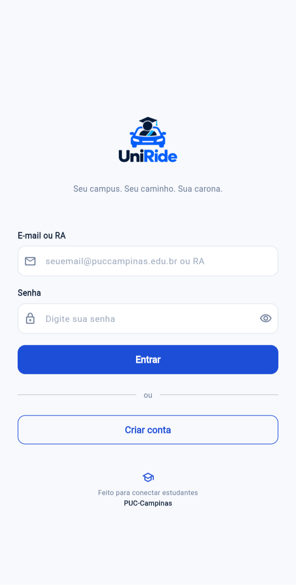 |
| 2. Cadastro | E1 | Formulário de cadastro, aberto sem envio. [Abrir PNG](img/02-cadastro.png).<br> |
| 3. Início e lista | E4, E8 | Ofertas carregadas pelo CT8. [Abrir PNG](img/03-inicio-lista.png).<br>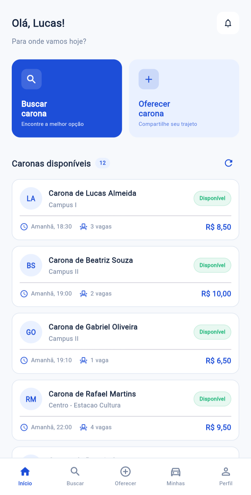 |
| 4. Perfil do motorista | E2 | Dados da conta demo, opção de motorista e avaliações. [Abrir PNG](img/04-perfil-motorista.png).<br>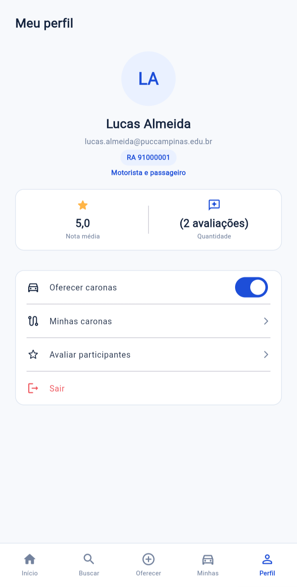 |
| 5. Oferecer carona | E3 | Campos da publicação. [Abrir PNG](img/05-oferecer-carona.png).<br>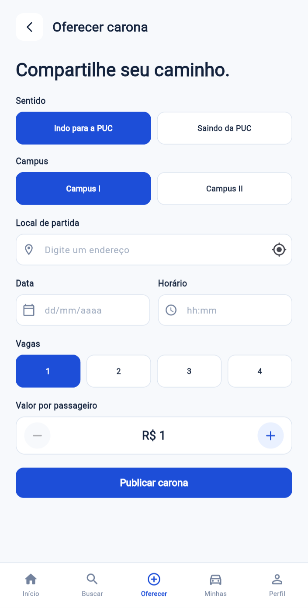 |
| 6. Busca preenchida | E5 | Sentido, campus, posição e horário da consulta. [Abrir PNG](img/06-busca.png).<br>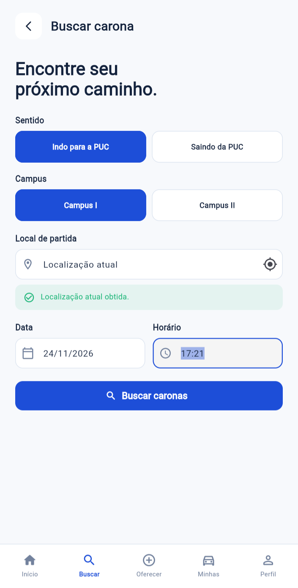 |
| 7. Resultados da busca | E5, E8 | Três caronas ranqueadas via CT9 e CT10. [Abrir PNG](img/14-resultados-busca.png).<br>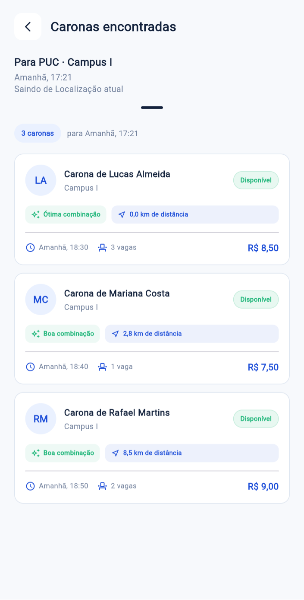 |
| 8. Detalhes da carona | E5, E6 | Trajeto, horário, vagas, valor e ação de solicitar. [Abrir PNG](img/13-detalhes-carona.png).<br>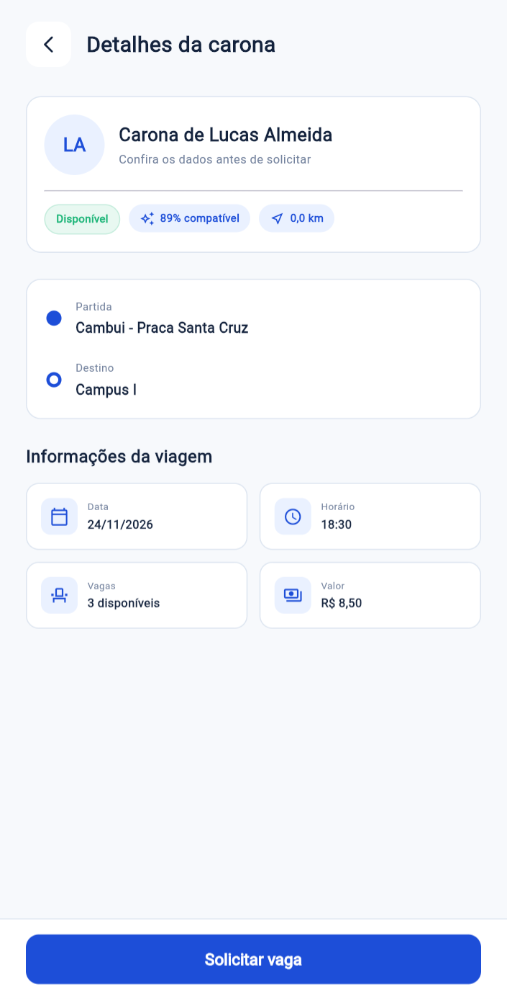 |
| 9. Solicitações recebidas | E6 | Pedido demo pendente na conta do motorista. [Abrir PNG](img/08-solicitacoes-recebidas.png).<br>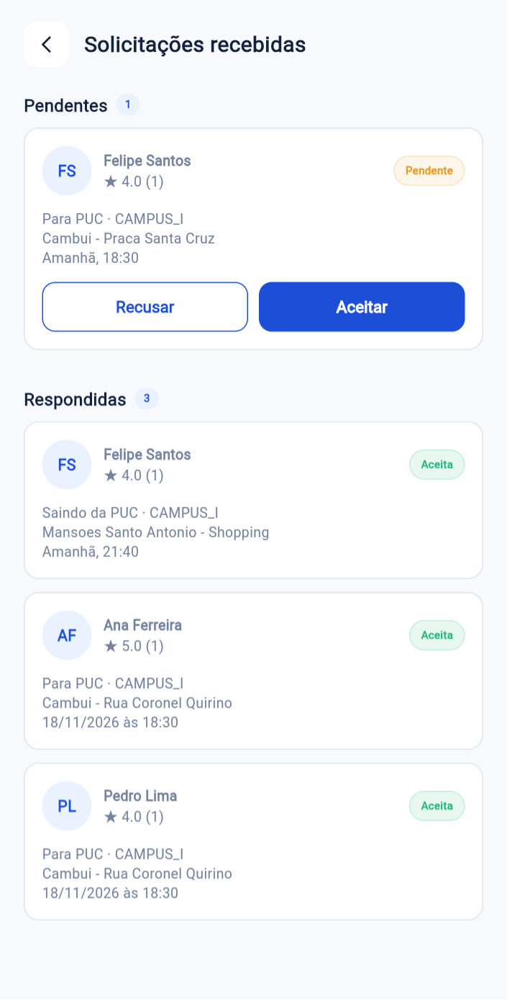 |
| 10. Minhas solicitações | E6 | Pedidos respondidos na conta da passageira. [Abrir PNG](img/09-minhas-solicitacoes.png).<br>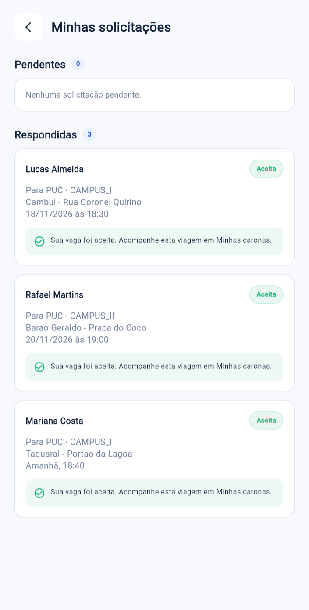 |
| 11. Aceite pelo motorista | E6, E8 | Pedido de Felipe após confirmação do aceite. [Abrir PNG](img/16-solicitacao-aceita-motorista.png).<br>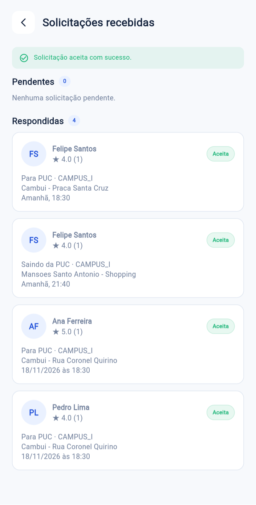 |
| 12. Aceite visto pelo passageiro | E6, E8 | Resposta da carona de Lucas exibida na conta de Felipe. [Abrir PNG](img/17-solicitacao-aceita-passageiro.png).<br>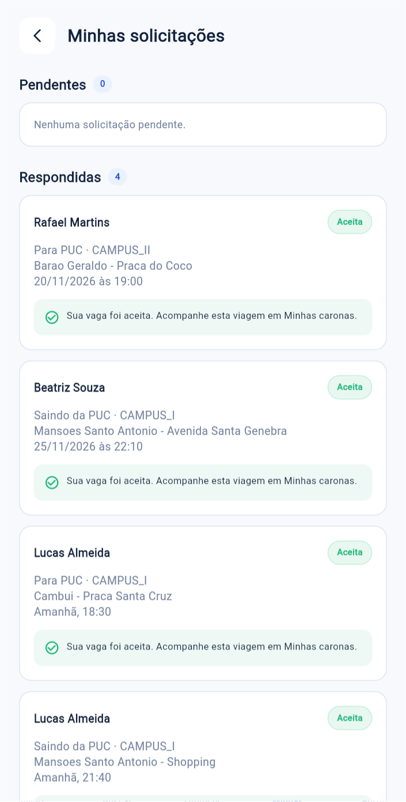 |
| 13. Minhas caronas | E7 | Histórico de ofertas carregado pelo CT18. [Abrir PNG](img/07-minhas-caronas.png).<br>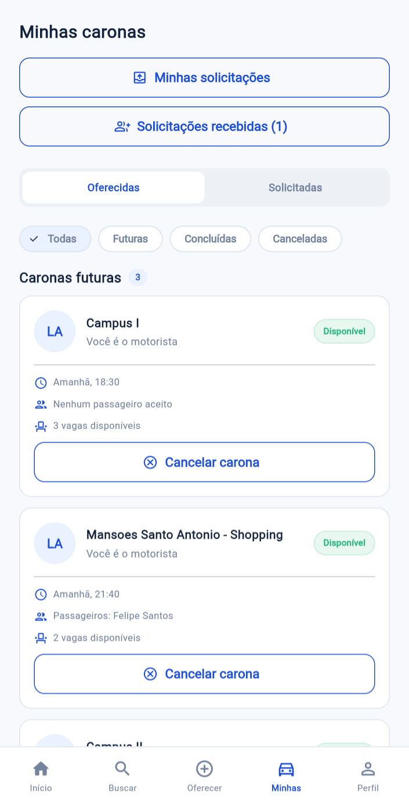 |
| 14. Carona concluída | E7 | Carona demo já concluída com opção de avaliar. [Abrir PNG](img/10-carona-concluida.png).<br>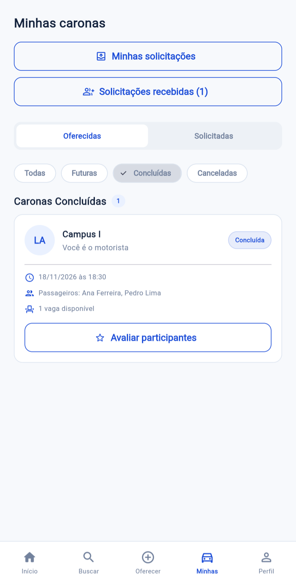 |
| 15. Seleção de participante | E7 | Passageiro elegível na carona concluída. [Abrir PNG](img/11-avaliacao.png).<br>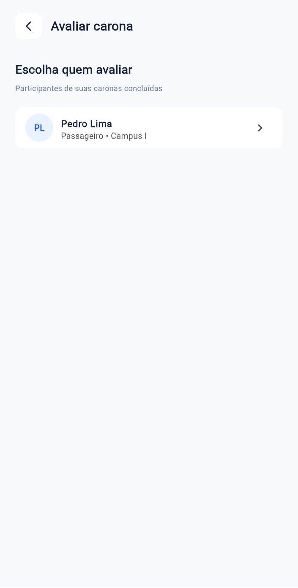 |
| 16. Formulário de avaliação | E7 | Seleção de nota para Pedro, sem envio. [Abrir PNG](img/15-formulario-avaliacao.png).<br>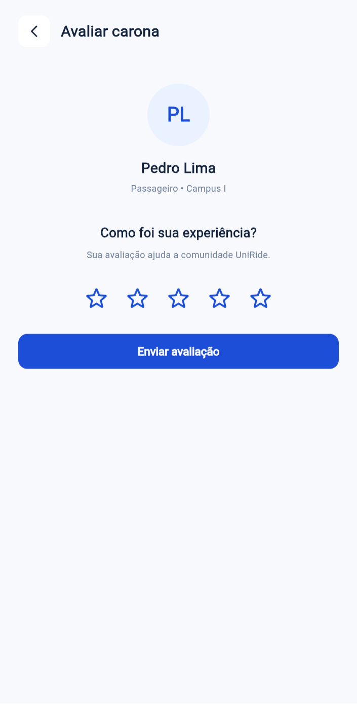 |
| 17. Notificações | E6, E8 | Avisos demo e leitura automática ao abrir. [Abrir PNG](img/12-notificacoes.png).<br>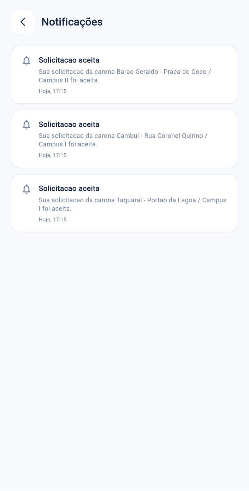 |

A captura de carona **Em curso** com o botão **Finalizar carona** e a confirmação de envio da avaliação dependem do roteiro do capítulo 7.

## 9. Como rodar

**Responsável pelo capítulo:** Victor Hugo Asvolinsque.

Este roteiro incorpora as instruções do [README principal](../README.md). O ambiente integrado precisa de Git, Docker Desktop/Compose e Flutter. Para Android, instalar também o Android SDK e preparar um emulador ou dispositivo. Para web, usar Chrome.

1. Clonar os quatro [repositórios](#11-anexos) lado a lado, preservando os nomes. Os contextos de build do Compose apontam para os dois diretórios irmãos dos backends.
2. Na raiz do repositório acadêmico, copiar o exemplo, configurar uma senha local do banco no `.env` e iniciar os serviços.

   ```powershell
   Copy-Item .env.example .env
   # Edite DB_PASSWORD no .env antes de executar o próximo comando.
   docker compose up --build
   ```

3. Consultar `http://localhost:8080/caronas` para conferir a API. No primeiro boot, o Flyway aplica V1–V9. O PostgreSQL usa healthcheck com `pg_isready`. O healthcheck do Backend 2 verifica apenas se o processo do contêiner está ativo. Para confirmar o TCP de ponta a ponta, executar uma busca no aplicativo.
4. Em outro terminal, na pasta do frontend, instalar dependências e iniciar o Flutter.

   ```powershell
   flutter pub get
   flutter run -d chrome
   ```

   Chrome usa `http://localhost:8080`. Em um Android Emulator, usar `flutter run` com o emulador disponível. O endereço padrão nesse caso é `http://10.0.2.2:8080`. Em aparelho físico, informar o IP do host com `--dart-define=API_BASE_URL=http://192.168.0.10:8080`, substituindo o IP do exemplo. O autocomplete público depende de acesso ao Photon.
5. O Compose ativa `demo`. Para demonstrar os papéis, usar Lucas Almeida (RA `91000001`, motorista) e Ana Ferreira (RA `91000006`, passageira), ambos com a senha de demonstração `Demo123!`. O [README principal](../README.md) lista as 11 contas e os registros demonstrativos. O seed usa datas relativas e é condicionado ao profile `demo & !test`. Uma reinicialização pode recriar dados associados às contas demo. Usar ambiente dedicado para demonstração.
6. Encerrar pela raiz acadêmica com `docker compose down`, que preserva o volume. A recriação com banco vazio exige um ambiente descartável, pois a opção `-v` remove o volume e seus dados.

A [configuração de exemplo](../.env.example) indica as variáveis de banco. Para executar os módulos separadamente, consultar o [README do frontend](https://github.com/ibrahimfcmneto/pi4-0101-g2-frontend/blob/cce418c1aed120dba3f969ff73305bb16bb66ee6/README.md), o [README do Backend 1](https://github.com/ibrahimfcmneto/pi4-0101-g2-backend-1/blob/a30416d62efc28a0d10019c53768e7891bdd843d/README.md) e o [README do Backend 2](https://github.com/ibrahimfcmneto/pi4-0101-g2-backend-2/blob/5c28974aa2a220f480a3107536462c98e3f25420/README.md).

### Uso por entregável

| Entregável | Como demonstrar |
| --- | --- |
| E1 | Na tela inicial de acesso, cadastrar uma conta de teste com RA e e-mail institucional únicos. Para repetir o login, sair e entrar com RA ou e-mail e senha. |
| E2 | Abrir Perfil, conferir os dados e alternar a opção de oferecer caronas em uma conta de teste. |
| E3 | Entrar como motorista e abrir Oferecer carona. Escolher sentido, campus, ponto variável, horário futuro, vagas e valor. Confirmar a publicação. |
| E4 | Abrir a lista inicial e localizar a oferta. Conferir horário, vagas e valor no card. |
| E5 | Abrir Buscar carona e usar o mesmo sentido, campus e dia da oferta. Informar um ponto variável e horário próximos, então abrir o resultado. |
| E6 | Como passageiro, solicitar vaga no detalhe e conferir Minhas solicitações. Como motorista, abrir Solicitações e responder. Usar outro pedido pendente para demonstrar cancelamento pelo passageiro. |
| E7 | Em Minhas caronas, escolher uma viagem com passageiro aceito e horário atingido. Finalizar como motorista e abrir a avaliação. Uma viagem demo já concluída pode demonstrar apenas a etapa de avaliação, se houver participante ainda elegível. |
| E8 | Com os serviços ativos, repetir CT8 no navegador e E5 pelo aplicativo. Usar os logs do Compose e uma consulta de leitura ao banco para evidenciar a API, a busca ligada ao Backend 2 e a persistência. |

Em 22/11/2026, a pilha do Compose foi iniciada com sucesso em ambiente temporário e volume novo. A inicialização, as migrations do PostgreSQL e as chamadas HTTP/TCP estão documentadas no [capítulo 7](#7-testes). A validação completa do README em uma máquina limpa permanece pendente.

## 10. Conclusão

**Responsável pelo capítulo:** Leonardo Carlos Barboza Filho.

O código examinado dá suporte à oferta, à busca ranqueada e à solicitação de caronas, com histórico e avaliações. A API Java persiste os dados no PostgreSQL e delega ao servidor TCP a compatibilidade. A pesquisa inicial motivou esses fluxos, mas a implementação por si só não mede redução de custos ou melhoria de segurança no deslocamento.

Dois pontos exigiram tratamento técnico específico. O CT8 omite o status, por isso o Flutter distingue “Disponível” e “Lotada” pelo número de vagas nesse contexto. No CT9, o Backend 1 reconsulta a elegibilidade depois de receber o ranking TCP, pois uma oferta pode deixar de estar disponível durante a análise. O histórico usa uma consulta separada da listagem pública para manter as caronas que já saíram da busca e permitir a avaliação.

A identificação por IDs explícitos limita o uso fora do ambiente acadêmico. A sugestão de endereços depende do Photon, e os relatórios automatizados em H2 não demonstram por si só o comportamento em PostgreSQL. Evoluções possíveis incluem autenticação por requisição antes de uma exposição pública, verificação de prontidão do CT10 e uma suíte integrada sobre PostgreSQL com evidência por revisão.

Os responsáveis pelos capítulos estão identificados, e o capítulo 8 reúne as 17 capturas reais. Para a versão de entrega, o grupo precisa fixar as revisões finais e completar as evidências manuais que ainda constam como pendentes. Cobertura, Sonar e o vínculo da Tarefa 6 no OpenProject dependem das confirmações descritas nos anexos.

## 11. Anexos

**Responsável pelo capítulo:** Tonianni Leitão Calsolari.

### A. Fontes e revisões examinadas

| Material | Local e revisão |
| --- | --- |
| Entrega 1 | [Escopo original](escopo.pdf), cinco páginas. Inclui pesquisa, objetivos, critérios de aceite e estimativa de viabilidade. |
| Repositório acadêmico | [GitHub](https://github.com/andres-claudino/pi4-2026-2-0101-grupo02), revisão local `4c44259035fcd6d1392f630aef0ee1e8a80ba58e` em `docs/atualiza-demo`. [README](../README.md), [Compose](../compose.yaml), [.env.example](../.env.example). |
| Frontend e material da Entrega 2 | [GitHub](https://github.com/ibrahimfcmneto/pi4-0101-g2-frontend), revisão `cce418c1aed120dba3f969ff73305bb16bb66ee6` em `feat/refatoracao-visual`. [Visão geral e fluxos](https://github.com/ibrahimfcmneto/pi4-0101-g2-frontend/tree/cce418c1aed120dba3f969ff73305bb16bb66ee6/docs/fluxos), [implementação](https://github.com/ibrahimfcmneto/pi4-0101-g2-frontend/tree/cce418c1aed120dba3f969ff73305bb16bb66ee6/lib) e [testes](https://github.com/ibrahimfcmneto/pi4-0101-g2-frontend/tree/cce418c1aed120dba3f969ff73305bb16bb66ee6/test). |
| Backend 1 | [GitHub](https://github.com/ibrahimfcmneto/pi4-0101-g2-backend-1), revisão `a30416d62efc28a0d10019c53768e7891bdd843d` em `fix/clock-demo`. [Contratos](https://github.com/ibrahimfcmneto/pi4-0101-g2-backend-1/tree/a30416d62efc28a0d10019c53768e7891bdd843d/docs/contratos), [ADRs](https://github.com/ibrahimfcmneto/pi4-0101-g2-backend-1/tree/a30416d62efc28a0d10019c53768e7891bdd843d/docs/adr), [código e recursos](https://github.com/ibrahimfcmneto/pi4-0101-g2-backend-1/tree/a30416d62efc28a0d10019c53768e7891bdd843d/src/main), [testes](https://github.com/ibrahimfcmneto/pi4-0101-g2-backend-1/tree/a30416d62efc28a0d10019c53768e7891bdd843d/src/test) e [CI](https://github.com/ibrahimfcmneto/pi4-0101-g2-backend-1/blob/a30416d62efc28a0d10019c53768e7891bdd843d/.github/workflows/ci.yml). |
| Backend 2 | [GitHub](https://github.com/ibrahimfcmneto/pi4-0101-g2-backend-2), revisão `5c28974aa2a220f480a3107536462c98e3f25420` em `main`. [CT10](https://github.com/ibrahimfcmneto/pi4-0101-g2-backend-2/blob/5c28974aa2a220f480a3107536462c98e3f25420/docs/contratos/CT10-analisar-compatibilidade.md), [código](https://github.com/ibrahimfcmneto/pi4-0101-g2-backend-2/tree/5c28974aa2a220f480a3107536462c98e3f25420/src/main), [testes](https://github.com/ibrahimfcmneto/pi4-0101-g2-backend-2/tree/5c28974aa2a220f480a3107536462c98e3f25420/src/test) e [CI](https://github.com/ibrahimfcmneto/pi4-0101-g2-backend-2/blob/5c28974aa2a220f480a3107536462c98e3f25420/.github/workflows/ci.yml). |

Os links técnicos para os outros repositórios apontam para os commits revisados. As três primeiras revisões de repositório da tabela estavam em branches de trabalho locais com SHA diferente da `main` remota consultada. O Backend 2 coincidiu com a `main` remota. Fixar os commits para a entrega evita que a versão demonstrada e o documento sejam comparados com bases diferentes.

### B. Links de entrega e evidências

| Item | Referência ou campo a preencher |
| --- | --- |
| Repositórios, escopo, fluxos, contratos e ADRs | Links e revisões na seção A e no capítulo 6. |
| Documento final | Link permanente da versão entregue, pendente. |
| Release | URL da release, tag e commits dos módulos utilizados, pendentes. |
| OpenProject | URL do pacote de trabalho da Tarefa 6 e links para defeitos, pendentes. O card da Entrega 1 é referenciado na seção C. |
| CI Backend 1 e Backend 2 | Backend 1 `a30416d`: [PR](https://github.com/ibrahimfcmneto/pi4-0101-g2-backend-1/actions/runs/42088978109) e [push](https://github.com/ibrahimfcmneto/pi4-0101-g2-backend-1/actions/runs/42088731144). Backend 2 `5c28974`: [push](https://github.com/ibrahimfcmneto/pi4-0101-g2-backend-2/actions/runs/39141572893). As três execuções concluíram com sucesso. |
| Frontend | Em `cce418c`, análise local sem apontamentos e 101 testes aprovados em 22/11/2026. A consulta por SHA retornou zero execuções de CI. |
| Sonar e cobertura | A verificação de 22/11/2026 não encontrou relatório local de cobertura, configuração Sonar versionada ou artefatos publicados nas execuções consultadas. Percentual de cobertura, painel Sonar e Quality Gate permanecem sem evidência. |
| Validação manual e capturas | Execução da interface em 23/11/2026 registrada no capítulo 7. Capturas reais e respectivas legendas no capítulo 8. Submissões e transições ainda não exercitadas seguem no roteiro de verificação. |

### C. Diferenças e registros a confirmar

| Item | Observação |
| --- | --- |
| Evolução do E5/E8 | O critério original é histórico. O fluxo atual exige o ponto variável e usa ranking CT10 em um servidor Java separado. |
| Visão geral da Entrega 2 | A linha do módulo Frontend menciona localização opcional como origem. O código e os fluxos E3/E5 já usam localização também na busca e como destino variável em `SAINDO_DA_PUC`. |
| Healthcheck de demonstração | O README diz que o Compose espera o Backend 2 ficar pronto. O teste `kill -0 1` verifica processo ativo, sem validar se o protocolo CT10 já responde. |
| Reinicialização do demo | Os READMEs descrevem idempotência. O seed atual remove caronas e registros vinculados à demonstração antes de repovoar. O efeito esperado é evitar duplicações, sem garantir preservação do histórico de uso daquelas contas. |
| Aceite de pedido após o início | O CT11 bloqueia novo pedido a partir do horário previsto. No CT14, o aceite exige carona disponível, solicitação pendente e vaga, sem conferir o horário previsto. Confirmar com o grupo qual comportamento apresentar se esse cenário for avaliado. |
| OpenProject | O escopo aponta o [card da Entrega 1](https://srv1889234.hstgr.cloud/projects/pi-iv-0101-g2/work_packages/156/activity). Confirmar vínculo, atividade, evidências e responsáveis da Tarefa 6 com o grupo. |
| Instruções do professor | A estrutura e os critérios usados nesta versão são os informados no pedido. O enunciado oficial da Tarefa 6 não foi localizado nos arquivos examinados. Conferir exigências adicionais e formato final antes da submissão. |
| Evidências da execução | Testes automatizados e integração HTTP/SQL de 22/11/2026, mais execução da interface em 23/11/2026, registrados no capítulo 7. Permanecem pendentes os fluxos manuais restantes, a captura de conclusão ativa e a instalação completa em máquina limpa. |
